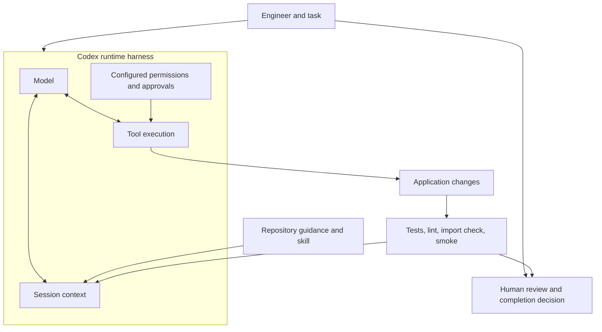
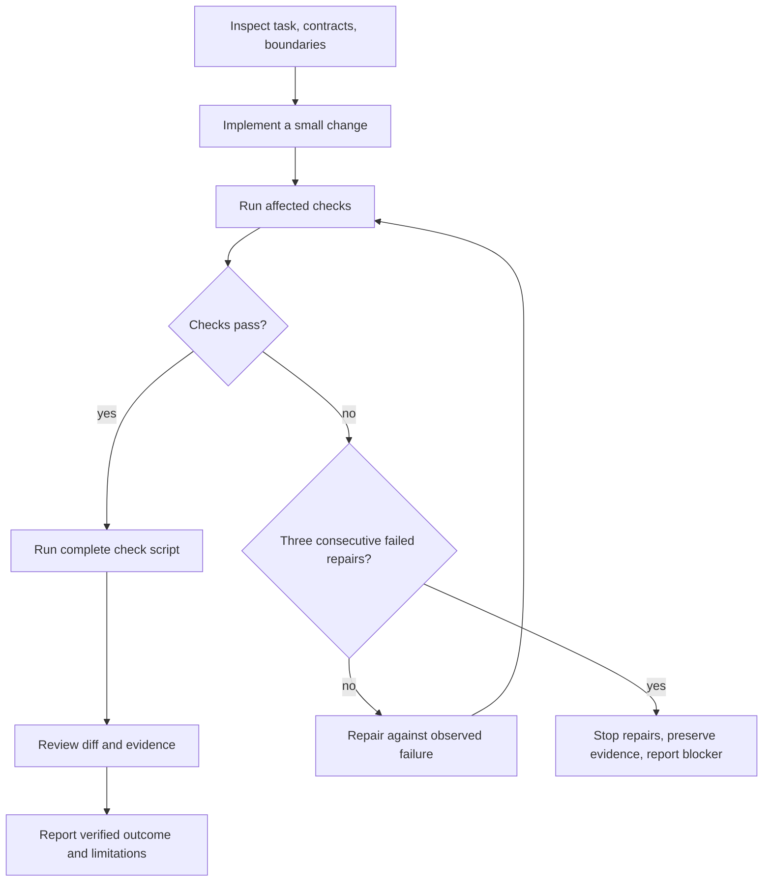

# From Prompt Engineering to Harness Engineering: A Reproducible Codex Example

A small API change can break a client without changing the extracted data. Suppose
an invoice service returns a `fields` object and a developer asks a coding agent to
add confidence scores. The agent might add `confidence: null` to every response,
coerce the string `"false"` into a boolean, or move extraction rules into an HTTP
handler. A happy-path test could pass while each of those decisions violates a
requirement.

This repository turns that situation into a concrete engineering exercise. It
contains a deterministic Python service, a frozen version before the feature,
checks that run without network access after setup, and a prepared comparison of
three repository configurations. The accompanying feature uses **rule-based
presence/validity scores**, not calibrated probabilities, model certainty, or
measured extraction accuracy. A valid-looking value can still be wrong for the
invoice a person intended.

The distinction matters throughout this article: the local implementation has
verification evidence; the proposed benefit of the agent-facing harness remains
a hypothesis. **Experiment prepared; agent trials not run.** There are no timing,
cost, token, or success-rate comparisons between agents to report.

## Three overlapping engineering concerns

These are practical working definitions rather than a universal taxonomy:

| Concern | Main question | Example here |
| --- | --- | --- |
| Prompt engineering | What task are we asking for? | Specify strict booleans and legacy response compatibility. |
| Context engineering | What information should be available, and where? | Put layer boundaries in a short architecture document. |
| Harness engineering | How is work executed, checked, and corrected? | Run fixed tests and inspect failures within bounded repairs. |

The categories overlap. A prompt can tell the agent which checks to run, and a
check failure becomes context for its next decision. A skill packages procedural
context, while its commands invoke executable feedback. Naming the categories is
useful when it helps identify a missing mechanism. It is less useful when every
additional instruction gets called an improvement without evidence.

For example, “preserve compatibility” is reasonable task wording, but ambiguous
until an expected response is written down. A regression test makes that expectation
observable for the examples it covers. An architecture guide explains where a
change belongs; an import checker detects some violations. Neither proves that
all future changes will be correct. Extra rules also consume attention and need
maintenance, so the appropriate amount of guidance is an empirical question.

## The model, the runtime, and this repository

A language model proposes actions and code. Codex supplies a surrounding runtime
for context, tools, execution, and configured operational boundaries. OpenAI's
[description of the Codex harness](https://developers.openai.com/blog/codex-as-a-platform)
explains that surrounding system. This project adds repository practices inside
that runtime; it does not implement a replacement coding-agent runtime.

The following is a conceptual diagram, not a trace of a measured trial:



Even the baseline arm uses Codex and its normal tools and safety controls.
Calling it baseline means fewer repository additions. It does not mean a bare
model with no runtime harness. This distinction prevents a misleading claim that
a repository shell script is responsible for capabilities already supplied by
the coding environment.

## A deliberately narrow service

The service accepts JSON text containing four labeled lines: `Invoice Number`,
`Date`, `Total`, and `Currency`. Labels match case-insensitively at the start of a
line, with surrounding whitespace and a colon. Unrelated lines are ignored. For
each field, the first valid matching line wins; an invalid first occurrence does
not block a later valid one.

Invoice numbers use a limited ASCII grammar. Dates must be actual calendar dates
in `YYYY-MM-DD` form. Totals accept nonnegative ASCII decimals with at most two
fractional digits; `Decimal` produces a two-decimal string. Exponents, commas,
signs, and Unicode decimal digits are rejected. Currency accepts exactly three
ASCII letters and returns uppercase. Missing or invalid fields become JSON null,
with all four keys retained.

This scope makes the rules inspectable. It also creates a strict limit on what
success means. The service does not read PDFs, upload files, run OCR or LLM
inference, manage queues, authenticate users, provision cloud infrastructure, or
deploy anything. It has no GPU requirement, model download, API key, or database.
Only synthetic documents belong in the fixtures. There is no claim of reliable
extraction from arbitrary invoices.

Document text is data. A line that says to execute a command or fetch a URL has
no authority. The implementation neither evaluates content nor uses it as a path
or network destination. Application code does not log document contents. These
are properties readers can inspect and test, rather than assumptions that an
instruction-like document will always be harmless in a different application.

## Where the guidance and checks live

The full construction brief remains at the root. Short experimental instructions
live in overlays so trial agents receive only their assigned feature task. The
compact tree below omits caches and generated environments:

```text
AGENTS.md
pyproject.toml, uv.lock, .python-version
.agents/skills/api-review/SKILL.md
src/document_extraction/
  main.py
  api/routes.py
  schemas/contracts.py
  services/extraction.py
  inference/rules.py
tests/{unit,integration,fixtures}/
scripts/{check.sh,check_architecture.py,smoke.py}
docs/{architecture.md,conventions.md,implementation-log.md}
experiments/
  starter/, overlays/{B,C}/, evaluator/
  tasks/confidence.md, protocol.json, manifests.json
  scripts/{prepare_trial.py,evaluate_trial.py,summarize.py}
  results/{README.md,runs.jsonl,summary.md}
```

Codex recognizes `AGENTS.md` as an instruction mechanism, with inherited guidance
also relevant; see the official
[custom-instructions documentation](https://learn.chatgpt.com/docs/agent-configuration/agents-md).
The [B instructions](../../experiments/overlays/B/AGENTS.md) specify purpose,
compatibility, boundaries, verification commands, and completion evidence. They
require reading the architecture document when changing boundaries and stay
below the construction brief's 100-line limit.

Repository skills use `.agents/skills/<name>/SKILL.md`, with a name and description
in YAML front matter. The official
[skill documentation](https://learn.chatgpt.com/docs/build-skills) describes
repository discovery, progressive loading, and invocation. Here the
[API review skill](../../.agents/skills/api-review/SKILL.md) asks for diff inspection,
old/new JSON comparison, input review, manual boundary inspection, and actual
check results. A reader can explicitly request it with `$api-review`.

Discovery is not evidence of use, and instructions do not enforce every sentence
they contain. The runtime may make skills available without invoking a particular
one. This construction explicitly read and applied the skill; future trials must
record observed use separately. The
[customization overview](https://learn.chatgpt.com/docs/customization/overview)
provides product context, but the particular procedure here is a project choice.

Other paths have no implied automatic behavior. `docs/architecture.md` becomes
useful when referenced or read. `scripts/check.sh` runs only when invoked. Keeping
that distinction explicit prevents a documentation folder from being mistaken
for an execution control.

## Boundaries that can be inspected

The [architecture guide](../architecture.md) specifies HTTP API → service →
deterministic extractor, with shared schema types. The composition root explicitly
creates the app and includes the router. Routes validate, delegate, and serialize.
The service imports no FastAPI, Starlette, or API modules. The extractor imports
no HTTP or service modules. Schemas have no upward dependencies.

The [AST checker](../../scripts/check_architecture.py) walks static imports under
one selected source package, including relative imports. Violations produce file
and line diagnostics and a nonzero status. Its unit fixtures exercise allowed
and forbidden edges, including `from .. import api`. Selecting one candidate
package avoids accidentally checking every frozen snapshot in the experiment
folder.

Static imports are a useful but incomplete oracle. They do not establish that a
route contains no parsing logic, detect every dynamic import, or prove business
correctness. The review skill therefore also inspects route delegation manually.
Pydantic result types are used across layers without importing the HTTP framework;
there is no pretend machine-learning abstraction around the regex rules.

## Adding optional scores while preserving JSON

Before the feature, this request returns only `fields`:

```json
{"text":"Invoice Number: INV-001\nDate: 2026-01-15\nTotal: 123.45\nCurrency: usd"}
```

```json
{"fields":{"invoice_number":"INV-001","date":"2026-01-15","total":"123.45","currency":"USD"}}
```

The feature adds `include_confidence`, a strict boolean with default false.
Omission and false preserve that response exactly. True adds a top-level object
with the same four field names and scores of 1.0 for valid values or 0.0 for null.
These numbers are only rule-based presence/validity indicators; a schema-valid
invoice number does not establish that it belongs to the intended document.

The following function is copied from the final
[service](../../src/document_extraction/services/extraction.py):

```python
def extract_document(text: str, include_confidence: bool = False) -> ExtractResponse:
    fields = extract(text)
    if include_confidence:
        scores = {
            key: 1.0 if value is not None else 0.0
            for key, value in fields.model_dump().items()
        }
        return ExtractResponse(fields=fields, confidence=Confidence(**scores))
    return ExtractResponse(fields=fields)
```

The [request schema](../../src/document_extraction/schemas/contracts.py) uses
`StrictBool` and `StrictStr`, forbids unknown properties, and checks original text
length before rejecting whitespace-only content. An integer flag or the string
`"true"` returns 422. Text over 10,000 characters is rejected even if trimming
would make it short. Malformed JSON also returns 422.

Serialization needs care: the response model has an optional confidence field,
but default legacy responses must omit that field. The
[route](../../src/document_extraction/api/routes.py) uses
`response_model_exclude_unset=True`. The service explicitly supplies confidence
only when requested. Extracted fields are explicitly populated, including nulls,
so preserving their keys does not depend on a blanket exclusion of null values.
The regression suite verifies the resulting JSON rather than merely inspecting
which model option was selected.

## Verification as a bounded feedback process

From a clean checkout, install using `uv sync --locked --group dev`, then run
`bash scripts/check.sh`. The committed lock comes from the resolver, not manually
selected package versions. The official
[uv project workflow](https://docs.astral.sh/uv/guides/projects/) explains its
project environment and lock mechanisms. The tested interpreter is Python 3.12.3;
[environment.json](../environment.json) records actual resolved versions and OS.

The verification commands are copied from [check.sh](../../scripts/check.sh):

```bash
uv run --locked --offline ruff check .
uv run --locked --offline ruff format --check .
uv run --locked --offline pytest -q
uv run --locked --offline python scripts/check_architecture.py
uv run --locked --offline python scripts/smoke.py
```

The wrapper changes reliably to the repository root and exits on failure. It
never formats or autofixes files. Explicit repair commands are separate, allowing
a reviewer to distinguish observing a failure from changing the candidate.
[Ruff](https://docs.astral.sh/ruff/) supplies lint and formatting checks;
[pytest](https://docs.pytest.org/en/stable/how-to/usage.html) supports explicit test
selection. Default test discovery stays under `tests`, so frozen and evaluator
suites do not accidentally join the ordinary run.

The smoke script uses TestClient in process, following the approach documented by
[FastAPI](https://fastapi.tiangolo.com/tutorial/testing/). It needs no server or
network connection. For manual exploration, the README binds Uvicorn to
`127.0.0.1`; exposing this teaching service publicly is outside scope.

This second diagram describes the intended feedback procedure:



The construction encountered real lint failures from long lines, repaired them
explicitly, and reran checks. It did not insert a teaching defect and present it
as an accidental agent failure. A bootstrap attempt also failed because Python's
ensurepip was unavailable; project-local uv installation provided a working path
without changing global tools. These events belong in the implementation log,
not in invented A/B/C results.

The tests cover exact legacy response shape, optional scores, invalid flag types,
complete/missing/invalid/duplicate fields, Unicode, calendar dates, decimal grammar,
original length boundaries, unknown properties, malformed JSON, deterministic
repetition, instruction-like text, and document-content logging. Hand-reviewed
synthetic fixtures make expected outputs visible. Current Starlette emits an
HTTPX TestClient deprecation warning; the requested HTTPX stack is retained and
the warning is recorded rather than hidden.

## Preparing a comparison without inventing results

The [experiment protocol](../../experiments/README.md) defines three inputs:

| Arm | Agent-visible additions | Execution status |
| --- | --- | --- |
| A | Frozen application, ordinary README, public tests and common prompt | Not run |
| B | A plus concise AGENTS.md and architecture guide | Not run |
| C | B plus review skill, checks and feedback workflow | Not run |

The starter was checked before the confidence implementation. SHA-256 manifests
freeze its source, lock, tests, prompt, evaluator, scoring rules and overlays.
Preparation copies starter plus the chosen overlay and verifies common hashes.
It refuses nonempty destinations and trial paths inside this construction tree.
No final solution or evaluator-only case is copied into a trial workspace.

The evaluator self-check on the starter passed regressions and failed all four
designated feature assertions for the expected reason. The same evaluator passed
all 49 cases on the final implementation. These are local evaluator self-checks,
not agent trials. Evidence resides in [starter-evaluator.json](../starter-evaluator.json)
and [final-evaluator.json](../final-evaluator.json). The results ledger is empty,
and its generated summary explicitly says “Not run.” There is no results chart.

Candidate evaluation uses a disposable copy and its own environment installed
from the candidate lock. It verifies module provenance before running fixed
external tests; accidentally importing this final example cannot count as success.
Changed protected public tests, dependency settings, or present C check scripts
are rejected. Collection failures and missing dependencies cannot satisfy the
expected starter feature failure. The original candidate is not repaired during
scoring.

## Isolation, metrics, and confounds

An authorized experiment would use fresh sessions outside this repository and its
ancestors, identical prompts, three repetitions per arm, and the frozen order
A/B/C, B/C/A, C/A/B. Each run gets fifteen minutes and at most three repairs. An
operator must record limits that the runtime cannot enforce or observe reliably.
Setup time is separate from task time. Failures and timeouts remain in denominators.

Exact model, reasoning setting, runtime version, permissions, network policy,
tools and hardware must be held fixed and recorded. Some execution settings remain
unresolved in the prepared protocol; no trial should claim control over unknown
settings. The installed Codex CLI help was inspected, and its syntax compared with
the official [CLI reference](https://learn.chatgpt.com/docs/cli/reference). The
manual fresh-session procedure is documented without launching a paid call.

A fresh directory is not sufficient isolation. Inherited instructions, user skills,
plugins, memories and configuration can affect all arms. A profile can layer
configuration without removing those sources. Likewise, an evaluator in another
directory is not hidden when the agent can read the filesystem. This build has
established neither a private evaluator barrier nor fully isolated runtime guidance.
Future runs must enforce those properties or label the resulting confounds and
call tests agent-visible.

Functional correctness and architecture are reported separately, then combined.
Manual review checks route delegation, forbidden imports, unrelated changes and
test weakening against a fixed rubric, recording reviewer identity and blinding.
Observable interventions and permission prompts are recorded separately. A human
hint does not disappear into elapsed time; the unassisted outcome must be saved.
Post-evaluation repair is a new demonstration rather than another scored attempt.

The summarizer validates records and rejects duplicates. Unavailable usage is null
with a reason, never zero. It retains unsuccessful attempts and lists missing data
and exclusions. Monetary comparisons require actual usage and dated cited rates;
this project has neither trial usage nor a cost claim. Even nine completed runs
on this one task would not establish statistical significance, general superiority,
or production safety. C changes a bundle, so any difference could not be assigned
to the skill or instruction file alone.

## What to adopt, and what to maintain

Start with one fragile compatibility requirement and a concrete expected output.
Keep a small architecture guide close to the code. Add a check only when its
failure tells an engineer something actionable. Use a skill for a review procedure
that benefits from repetition, and distinguish manual judgments from executable
constraints. Preserve a pre-change snapshot before making comparative claims.

Every mechanism carries maintenance cost. Fixtures can encode a mistaken contract;
a weak oracle can reward the wrong implementation. Import rules can become stale
as boundaries change. Long instructions can distract from a narrow task. An agent
can run an inappropriate command if permissions and human oversight are treated
as documentation alone. More autonomous execution should stay within the task's
actual authorization, with explicit stopping conditions and evidence preservation.

This example establishes an inspectable local implementation and a prepared
measurement procedure. It does not establish that the additional harness improves
Codex outcomes. Readers can reproduce the service and checks without conducting
agent trials, then decide whether a separately authorized comparison is worth its
cost. That separation makes the engineering example useful even when the honest
experimental result is still “Not run.”
